<!-- palette: night #0D1117 · surface #161B22 · border #30363D · amber #E6B17E · rose #C98B8B · sage #8FB996 · text #E6EDF3 · muted #8B949E -->

<div align="center">



<br/>

<a href="https://git.io/typing-svg">
  
</a>

<br/><br/>


</div>

<br/>

<table>
<tr>
<td width="58%" valign="top">

### About

I'm **Lithira**, a digital creator who believes good interfaces should feel like a quiet room at night: calm, familiar and quietly delightful.

I design in Figma, build in React and Next.js, and spend a long time on the small details: a soft shadow, a gentle transition, a button that feels just right to press.

</td>
<td width="42%" valign="top">

### Right now

```txt
building   ->  full-stack web apps
reading    ->  design systems
learning   ->  motion & micro-UX
ask me     ->  UI, React, Figma
```

</td>
</tr>
</table>

<div align="center">

</div>

### Toolbox

<div align="center">

**Languages**  


**Frontend**  


**Backend & Database**  


**DevOps & Tools**  


**Design**  


<sub>also: Framer Motion · GSAP · Socket.IO · Mongoose · Spring Security · React Router</sub>

</div>

<div align="center">

</div>

### Live Projects

<table>
<tr>
<td width="50%" valign="top">

#### Personal Portfolio
<sub>My portfolio site with 3D and motion-driven interactions.</sub>

<sub><code>Next.js · React · TypeScript · Tailwind · Three.js · GSAP</code></sub>

<a href="https://lithirasilva.vercel.app/"></a>
<a href="https://github.com/Lithira-Silva/Lithira-silva-cyberpunk-portfolio"></a>

</td>
<td width="50%" valign="top">

#### Capital V Solutions
<sub>Premium B2B technology consulting homepage with an Apple-inspired UI.</sub>

<sub><code>Next.js · TypeScript · Tailwind · Framer Motion</code></sub>

<a href="https://capital-v-solutions.vercel.app"></a>
<a href="https://github.com/Lithira-Silva/capital-v-solutions"></a>

</td>
</tr>
<tr>
<td width="50%" valign="top">

#### FitGeek
<sub>Modern fitness website with client-side routing and a contact form.</sub>

<sub><code>React · TypeScript · Vite · Tailwind</code></sub>

<a href="https://fitgeek-website.vercel.app"></a>
<a href="https://github.com/Lithira-Silva/fitgeek-website"></a>

</td>
<td width="50%" valign="top">

#### SportsX
<sub>Indoor cricket booking website with slot booking, login and simulated payments.</sub>

<sub><code>React · Vite · Tailwind · React Router</code></sub>

<a href="https://sportsx-delta.vercel.app"></a>
<a href="https://github.com/Lithira-Silva/sportsx"></a>

</td>
</tr>
</table>

<div align="center">

</div>

### GitHub Activity

<div align="center">


</div>

<div align="center">

</div>

### Connect

<div align="center">

<a href="https://www.linkedin.com/in/lithira-silva-20b42a370"></a>
<a href="https://github.com/Lithira-Silva"></a>
<a href="https://github.com/lithira-works"></a>
<a href="https://lithirasilva.vercel.app/"></a>

<br/><br/>

<sub><i>make it simple, make it calm, make it yours.</i></sub>

<br/><br/>


</div>
